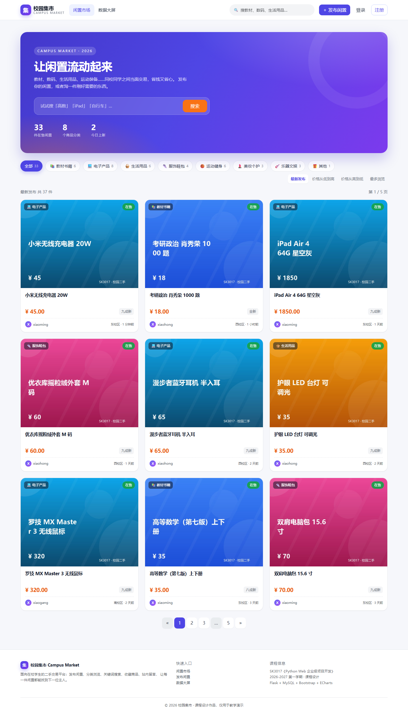
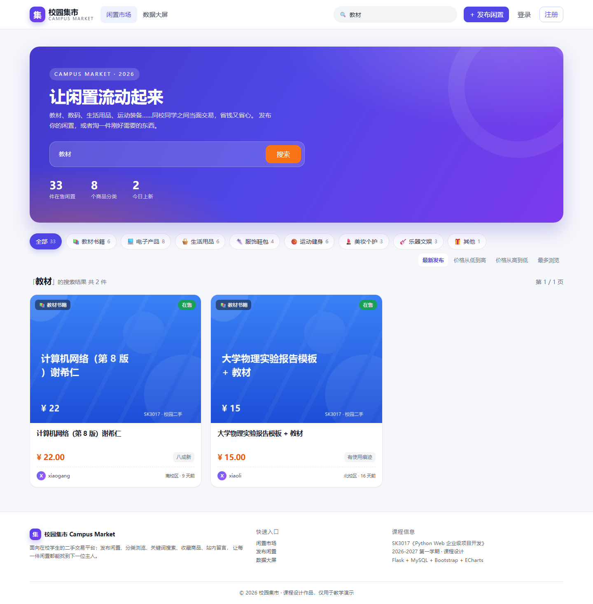
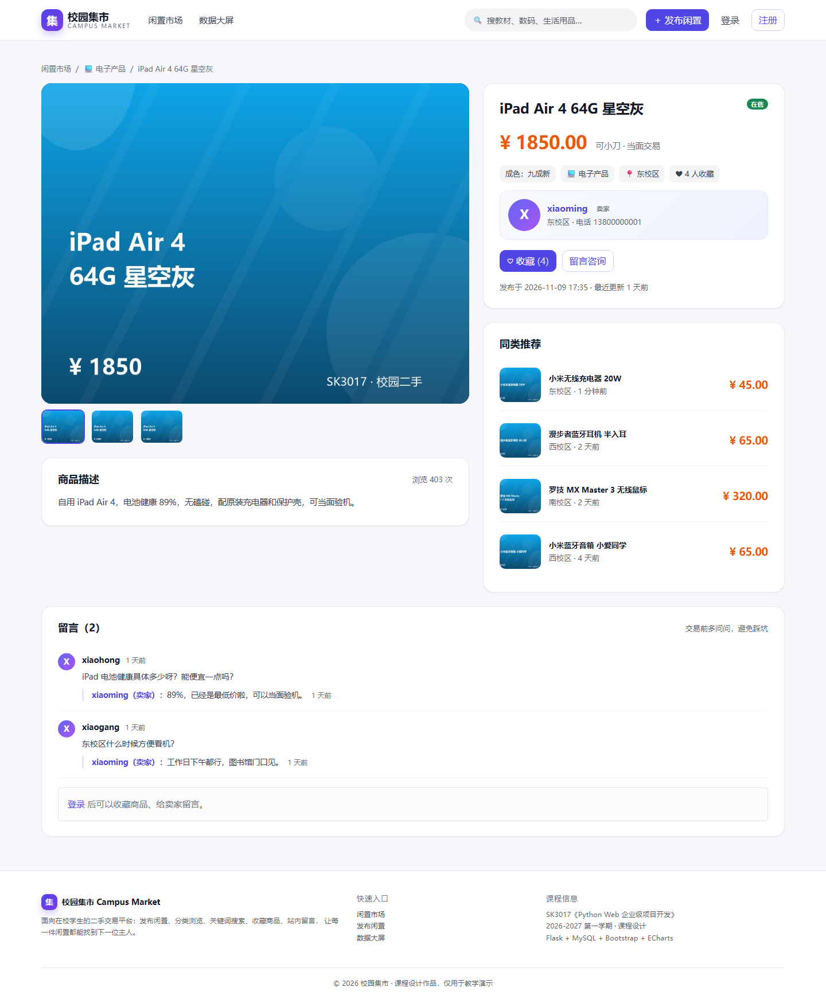
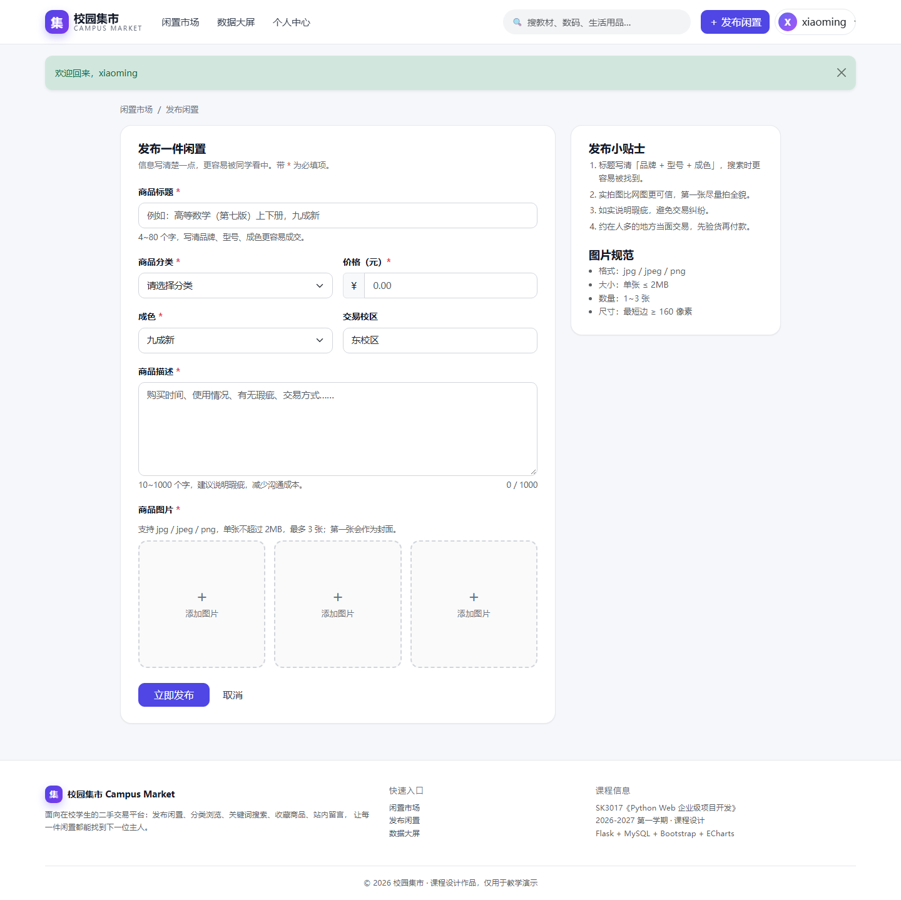
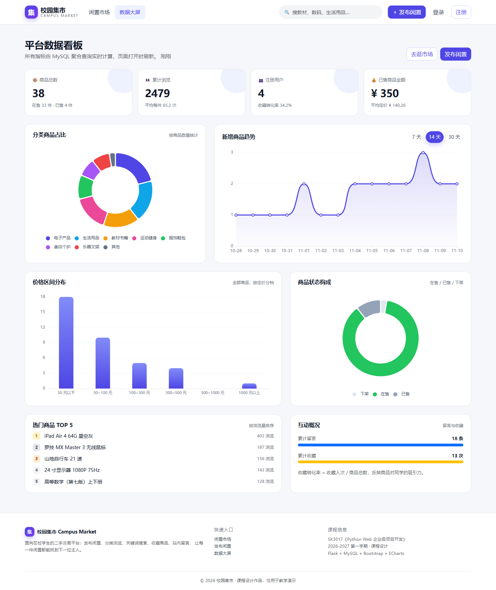

课程设计选题：题目二-校园二手交易平台

# 校园集市 Campus Market

> SK3017《Python Web 企业级项目开发》课程设计 · 2026-2027 第一学期
> 基于 Flask + MySQL 的校园二手交易平台：发布闲置、分类浏览、关键词搜索、收藏、站内留言与数据看板。



## 一、项目简介

校园里每年都会产生大量"用不上但舍不得扔"的物品：教材、数码配件、生活用品、运动装备……
传统做法是发群消息、贴海报，信息分散、搜索困难、成交效率低。**校园集市**把这条链路搬到 Web 上：

- 卖家：注册 → 发布商品（标题/描述/价格/成色/分类/1~3 张图）→ 在个人中心管理状态与留言；
- 买家：浏览/分类筛选 → 关键词搜索 → 查看详情 → 收藏 → 留言咨询 → 线下当面交易；
- 平台：用数据看板展示商品规模、分类结构、发布趋势、价格分布与互动情况。

项目采用**前后端不分离**架构（Jinja2 服务端渲染 + 局部 Ajax），数据库使用 MySQL 8，
统计图表使用 ECharts 5，界面基于 Bootstrap 5 并做了移动端适配。

## 二、功能清单

### 2.1 基础功能（按选题要求逐项实现）

| 模块 | 功能 | 说明 |
|---|---|---|
| 用户 | 注册 / 登录 / 退出 | 密码使用 Werkzeug 哈希存储；支持用户名或邮箱登录；`?next=` 回跳做了同源校验 |
| 用户 | 个人资料 / 修改密码 | 校验旧密码；邮箱唯一性校验 |
| 商品 | 发布 | 标题、描述、分类、价格、成色、校区、1~3 张图片；服务端全量校验 |
| 商品 | 编辑 / 改状态 / 删除 | 仅发布者可操作；状态支持 在售 / 已售 / 下架；删除有二次确认 |
| 商品 | 图片上传 | 仅 jpg/jpeg/png、单张 ≤ 2MB、最短边 ≥ 160px；校验真实图片内容并重编码，UUID 重命名 |
| 浏览 | 首页列表 | 最新 / 价格升降 / 最多浏览四种排序 |
| 浏览 | 分类筛选 | 8 个校园常见分类，分类芯片显示在售数量 |
| 浏览 | 关键词搜索 | 标题 + 描述模糊匹配；`%`、`_`、`\` 已转义；搜索结果支持分页 |
| 浏览 | 分页 | 每页 9 条；页码参数校验为正整数，非法值回退第 1 页 |
| 详情 | 图片画廊 / 卖家信息 | 多图切换；卖家主页入口；同类商品推荐 |
| 收藏 | 收藏 / 取消收藏 | Ajax 局部刷新；数据库唯一约束 + 应用层判重，重复收藏给出提示 |
| 留言 | 买家留言 / 卖家回复 | 需登录；卖家可在留言下回复；长度 2~500 字 |
| 个人中心 | 我发布的 / 我的收藏 / 收到的留言 | 分页展示，支持改状态、删除、直接回复 |

### 2.2 扩展功能（加分项）

- **数据看板 `/stats`**：4 个 ECharts 图表（分类占比环形图、新增商品趋势面积图、价格区间柱状图、
  商品状态环形图）+ 4 个 KPI 指标卡 + 热门商品 TOP5 + 互动概况，全部由 MySQL 聚合查询驱动。
- **AJAX 收藏**：无整页刷新、失败有 toast 提示、未登录返回 401 并由前端跳转登录。
- **CSRF 防护**：所有写操作校验 session 中的随机令牌；表单与 Ajax 双通道传递。
- **统一错误页**：400 / 403 / 404 / 413 / 500；Ajax 请求返回结构化 JSON。
- **安全响应头**：`X-Content-Type-Options`、`X-Frame-Options`、`Referrer-Policy`。
- **可复现演示数据**：`flask seed-db` 一条命令生成 4 个用户、38 件商品、50 张图片、收藏与留言。

## 三、技术栈

| 层次 | 技术 |
|---|---|
| 语言 / 框架 | Python 3.13、Flask 3.1、Flask-SQLAlchemy 3.1、SQLAlchemy 2.0 |
| 数据库 | MySQL 8.0（utf8mb4）、PyMySQL 驱动 |
| 模板 / 样式 | Jinja2、Bootstrap 5.6、自定义 CSS（设计变量 + 响应式） |
| 前端交互 | 原生 JavaScript（Fetch API、图片预览、画廊、Toast） |
| 图表 | ECharts 5.6（本地静态文件，无需外网 CDN） |
| 测试 | requests 端到端冒烟脚本（52 项断言） |

## 四、目录结构

```
sk3017-campus-market/
├── README.md
├── requirements.txt
├── run.py                     # 启动入口
├── .env.example               # 环境变量模板（复制为 .env）
├── .gitignore
├── app/
│   ├── __init__.py            # 应用工厂、请求钩子、错误处理、模板过滤器
│   ├── config.py              # 配置（数据库连接来自环境变量）
│   ├── extensions.py          # SQLAlchemy 实例
│   ├── models.py              # 6 张表的 ORM 模型
│   ├── utils.py               # 登录/CSRF/图片校验/分页/LIKE 转义
│   ├── seed_data.py           # 演示数据定义
│   ├── cli.py                 # init-db / seed-db / drop-db 命令
│   ├── auth/                  # 注册、登录、退出
│   ├── market/                # 首页、详情、发布、编辑、收藏、留言
│   ├── user/                  # 个人中心、我的商品、收藏、留言、资料
│   ├── stats/                 # 数据看板 + 4 个聚合接口
│   ├── templates/             # Jinja2 模板（base + 各模块 + 宏）
│   └── static/
│       ├── css/ js/ img/
│       ├── uploads/items/     # 商品图片（运行时生成）
│       └── vendor/            # Bootstrap / ECharts 本地副本
├── database/
│   ├── schema.sql             # 建库建表脚本（含索引与注释）
│   └── README.md              # 数据库初始化说明
├── docs/
│   ├── 课程设计报告.pdf
│   ├── 设计文档.md
│   ├── DEVELOPMENT_LOG.md
│   ├── DEBUG_LOG.md
│   ├── AI协作记录.md
│   └── images/                # 架构图、ER 图、功能结构图
├── screenshots/               # 功能演示截图（9 张）
├── tests/
│   └── smoke_test.py          # 端到端冒烟测试
└── tools/
    ├── screenshot.py          # headless Chrome 截图脚本
    └── make_diagrams.py       # 生成架构图 / ER 图
```

## 五、运行说明

### 5.1 环境要求

- Python 3.10+（开发使用 3.13.5）
- MySQL 5.7+ / 8.0（开发使用 8.0.42）
- 浏览器：Chrome / Edge 等现代浏览器

### 5.2 安装依赖

```bash
python -m venv .venv
# Windows
.venv\Scripts\activate
# macOS / Linux
source .venv/bin/activate

pip install -r requirements.txt
```

### 5.3 初始化数据库

方式一（推荐，自动建库建表并写入演示数据）：

```bash
# 1. 创建数据库（如果还没有）
mysql -uroot -p -e "CREATE DATABASE sk3017_market DEFAULT CHARACTER SET utf8mb4;"

# 2. 配置连接信息
copy .env.example .env      # Windows
# cp .env.example .env      # macOS / Linux
# 编辑 .env，填写 DB_PASSWORD 等

# 3. 建表
flask --app run.py init-db

# 4. 写入演示数据（会清空现有数据并重新生成图片）
flask --app run.py seed-db
```

方式二（只用 SQL 脚本建表，数据需另行造）：

```bash
mysql -uroot -p < database/schema.sql
```

### 5.4 启动

```bash
python run.py
# 浏览器访问 http://127.0.0.1:5000
```

生产环境建议：

```bash
pip install waitress
waitress-serve --listen=0.0.0.0:5000 run:app
```

### 5.5 测试账号

| 用户名 | 密码 | 校区 | 说明 |
|---|---|---|---|
| `xiaoming` | `123456` | 东校区 | 主要演示账号，有发布、收藏、留言 |
| `xiaohong` | `123456` | 西校区 | 用于演示"非卖家不能编辑"等权限 |
| `xiaogang` | `123456` | 南校区 | — |
| `xiaoli` | `123456` | 北校区 | — |

## 六、功能演示路径（建议按顺序）

1. **游客**：首页 → 分类筛选 → 搜索"教材" → 翻页 → 商品详情 → 登录。
2. **发布**：发布闲置 → 填表 → 上传 2 张图 → 发布成功 → 详情页可见。
3. **异常场景**：
   - 上传超过 2MB 的图片 → 提示"图片不能超过 2MB"；
   - 上传 `.txt` 或把文本改名成 `.jpg` → 提示"文件内容不是有效的图片"；
   - 搜索 `%`、`'`、`_` → 正常返回，不会把全表匹配出来。
4. **收藏**：在详情页点收藏 → 按钮变"已收藏" → 个人中心"我的收藏"可见 → 再点取消。
5. **留言**：用 `xiaohong` 留言 → 用 `xiaoming` 在"收到的留言"或详情页回复。
6. **数据看板**：`/stats` → 查看 4 个图表 → 切换 7/14/30 天趋势。

## 七、运行测试

先启动应用，再执行：

```bash
python tests/smoke_test.py
```

脚本会真实地注册/登录、发布并删除商品、收藏/取消收藏、留言/回复，并断言：
上传超大图片被拒、伪造扩展名被拒、非卖家编辑返回 403、未登录 Ajax 返回 401、
缺少 CSRF 返回 400、非法分页参数不报错等。当前结果：**52 项全部通过**（详见 `docs/测试报告.md`）。

不启动服务也可以跑 `utils.py` 的单元测试：

```bash
pip install -r requirements-dev.txt
pytest tests/test_utils.py      # 9 项通过
```

## 八、界面截图

| 页面 | 截图 |
|---|---|
| 首页 / 搜索 / 筛选 |  |
| 关键词搜索 |  |
| 商品详情 / 留言 |  |
| 发布闲置 |  |
| 数据看板 |  |

其余截图见 `screenshots/`：登录页、个人主页、我发布的、收到的留言。

## 九、文档

- [设计文档](docs/设计文档.md)（ER 图、表结构、接口清单、核心流程、安全设计）
- [开发日志](docs/DEVELOPMENT_LOG.md)
- [Debug 日志](docs/DEBUG_LOG.md)
- [AI 协作记录](docs/AI协作记录.md)
- [测试报告](docs/测试报告.md)
- [课程设计报告 PDF](docs/课程设计报告.pdf)
- [提交指南](docs/提交指南.md)（姓名/学号/仓库链接等提交前需替换的位置）

## 十、安全与异常处理

- **SQL 注入**：全部通过 SQLAlchemy 参数化查询，无字符串拼接 SQL；LIKE 通配符单独转义。
- **XSS**：Jinja2 默认自动转义；用户输入不参与 `|safe` 渲染。
- **CSRF**：写操作统一校验令牌，Ajax 通过 `X-CSRF-Token` 头传递。
- **越权**：编辑/改状态/删除/回复均校验 `seller_id` 或商品归属，非本人返回 403。
- **上传**：扩展名 + 大小 + Pillow 内容识别 + 真实格式 + 最小尺寸五层校验；重编码去除 EXIF；
  UUID 重命名避免路径穿越与重名覆盖。
- **其他**：密码哈希、登录失败不区分账号/密码错误、`next` 参数防开放重定向、
  统一错误页不泄露堆栈。

## 十一、已知限制与后续计划

1. 目前为单人本地部署，图片存本地磁盘；后续可接入对象存储（OSS/MinIO）。
2. 站内没有即时聊天，仅留言板；可扩展 WebSocket 实时沟通。
3. 收藏/浏览统计为同步写库，流量大时可改为异步队列 + 缓存计数。
4. 可增加举报、信用评分、校验证件等治理功能。

---

课程设计说明：本项目按《SK3017 课程设计选题题库》**题目二**独立完成，
仓库链接：`https://gitee.com/你的用户名/sk3017-campus-market`（提交前请替换为自己的仓库地址）。
