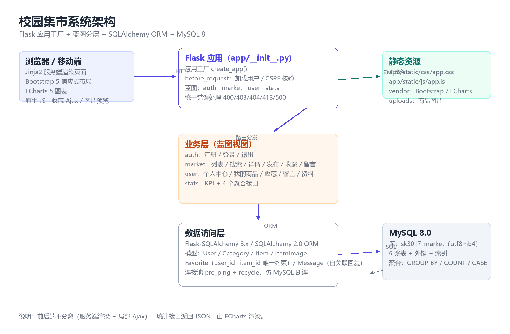
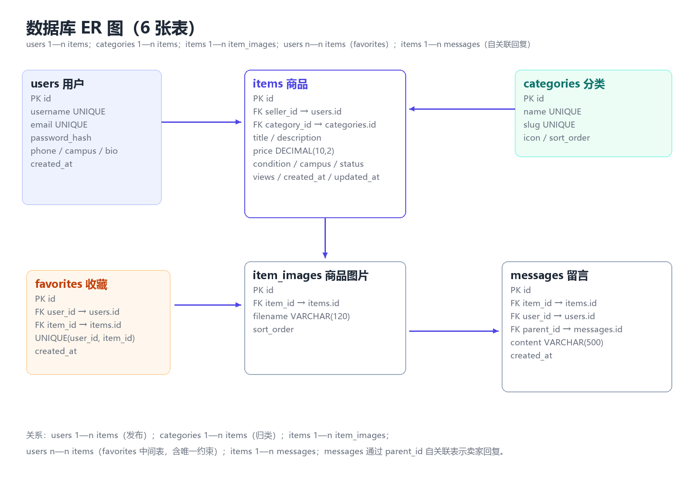
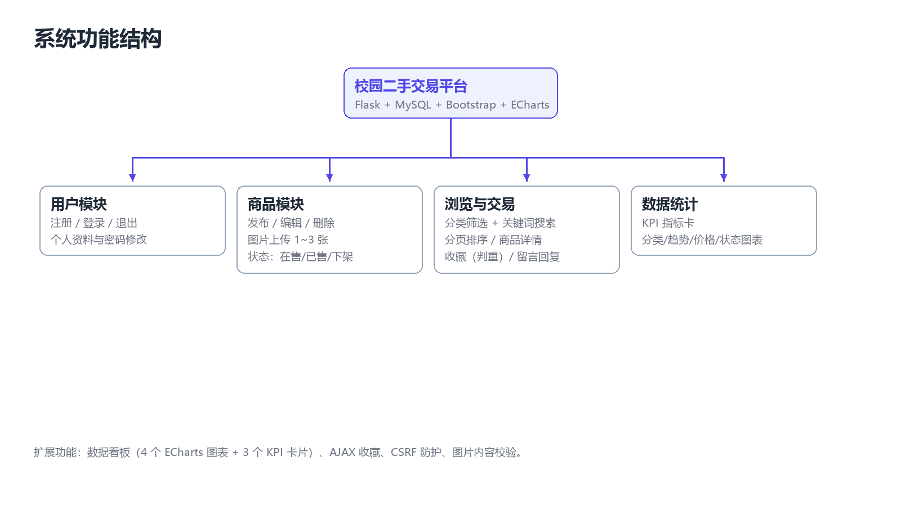

# 校园集市 · 设计文档

> 课程设计选题：题目二 — 校园二手交易平台
> 技术栈：Flask 3.1 + MySQL 8.0 + Bootstrap 5.6 + ECharts 5.6

## 一、需求分析

### 1.1 角色与目标

| 角色 | 目标 | 主要操作 |
|---|---|---|
| 游客 | 快速找到想要的二手物品 | 浏览、分类筛选、搜索、查看详情 |
| 买家（已登录） | 收藏心仪商品、与卖家确认细节 | 收藏/取消收藏、留言、查看我的收藏 |
| 卖家 | 高效发布与维护商品 | 发布、编辑、改状态、删除、回复留言 |
| 平台运营（演示） | 了解平台规模与结构 | 查看数据看板 |

### 1.2 核心用例

1. **发布商品**：登录 → 填写标题/描述/价格/分类/成色/校区 → 上传 1~3 张图 → 提交 → 跳转详情。
2. **搜索商品**：输入关键词 → 标题/描述模糊匹配 → 分类与排序可叠加 → 分页。
3. **收藏商品**：详情页点击收藏 → Ajax 局部更新 → 个人中心可见 → 再次点击取消。
4. **留言咨询**：买家留言 → 卖家在详情页或"收到的留言"回复 → 双方均可见。
5. **管理商品**：卖家在个人中心修改状态（在售/已售/下架）或删除。
6. **查看数据**：任一用户访问 `/stats` 查看聚合图表。

### 1.3 非功能需求

- **安全**：密码哈希、CSRF、越权校验、上传内容校验、SQL 参数化。
- **健壮**：非法分页参数、超大图片、伪造图片、重复收藏、过期表单均不能导致 500。
- **体验**：1440px 与移动端均可正常使用；操作有明确反馈（flash / toast / 错误页）。
- **可复现**：一条命令初始化数据库与演示数据。

## 二、系统架构



### 2.1 分层说明

| 层 | 位置 | 职责 |
|---|---|---|
| 表现层 | `app/templates` + `app/static` | Jinja2 渲染、Bootstrap 布局、原生 JS 交互、ECharts 图表 |
| 应用层 | `app/__init__.py` | 应用工厂、配置加载、蓝图注册、`before_request`（加载用户 / CSRF）、错误处理 |
| 业务层 | `app/auth` `app/market` `app/user` `app/stats` | 路由与业务校验、权限判断、事务提交 |
| 数据层 | `app/models.py` + Flask-SQLAlchemy | ORM 映射、关系与级联、聚合查询 |
| 存储层 | MySQL 8.0 + `static/uploads` | 结构化数据 + 图片文件 |

采用**应用工厂 + 蓝图**而非单文件：每个模块一个蓝图、一个视图文件，路由前缀清晰；
`extensions.py` 单独存放 `db` 实例，避免工厂与模型循环导入。

### 2.2 请求生命周期

```
请求 → load_logged_in_user（查一次用户挂到 g）
     → protect_from_csrf（写操作校验令牌）
     → 蓝图视图（校验参数 / 权限 / 查询）
     → 模板渲染（context_processor 注入 current_user、分类、CSRF）
     → after_request 加安全响应头
异常 → 400/403/404/413/500 统一处理（Ajax 返回 JSON）
```

## 三、数据库设计

### 3.1 ER 图



### 3.2 表结构

#### users 用户表

| 字段 | 类型 | 约束 | 说明 |
|---|---|---|---|
| id | INT | PK, AUTO_INCREMENT | 主键 |
| username | VARCHAR(32) | NOT NULL, UNIQUE | 登录名 |
| email | VARCHAR(120) | NOT NULL, UNIQUE | 邮箱 |
| password_hash | VARCHAR(255) | NOT NULL | Werkzeug 哈希 |
| phone | VARCHAR(20) | DEFAULT '' | 手机号 |
| campus | VARCHAR(64) | DEFAULT '' | 校区 |
| bio | VARCHAR(200) | DEFAULT '' | 签名 |
| created_at | DATETIME | NOT NULL | 注册时间 |

#### categories 分类表

| 字段 | 类型 | 约束 | 说明 |
|---|---|---|---|
| id | INT | PK | 主键 |
| name | VARCHAR(32) | NOT NULL, UNIQUE | 分类名 |
| slug | VARCHAR(32) | NOT NULL, UNIQUE | URL 标识 |
| icon | VARCHAR(16) | DEFAULT '📦' | emoji 图标 |
| sort_order | INT | DEFAULT 0 | 排序 |

#### items 商品表

| 字段 | 类型 | 约束 | 说明 |
|---|---|---|---|
| id | INT | PK | 主键 |
| title | VARCHAR(80) | NOT NULL | 标题 |
| description | TEXT | NOT NULL | 描述 |
| price | DECIMAL(10,2) | NOT NULL | 价格，避免浮点误差 |
| condition | VARCHAR(16) | NOT NULL | 成色 |
| campus | VARCHAR(64) | DEFAULT '' | 交易校区 |
| status | VARCHAR(8) | NOT NULL, INDEX | 在售/已售/下架 |
| views | INT | NOT NULL DEFAULT 0 | 浏览量 |
| seller_id | INT | FK → users.id, INDEX | 卖家 |
| category_id | INT | FK → categories.id, INDEX | 分类 |
| created_at | DATETIME | NOT NULL, INDEX | 发布时间 |
| updated_at | DATETIME | NOT NULL | 编辑时间（浏览不更新） |

> `price` 用 `DECIMAL(10,2)` 而不是 `FLOAT`：金额必须精确到分，浮点会出现 0.1+0.2 这类误差。
> `condition` 是 MySQL 关键字，DDL 中需用反引号包裹。

#### item_images 商品图片表

| 字段 | 类型 | 约束 | 说明 |
|---|---|---|---|
| id | INT | PK | 主键 |
| item_id | INT | FK → items.id, INDEX | 所属商品 |
| filename | VARCHAR(120) | NOT NULL | UUID 文件名 |
| sort_order | INT | DEFAULT 0 | 0 为封面 |

#### favorites 收藏表

| 字段 | 类型 | 约束 | 说明 |
|---|---|---|---|
| id | INT | PK | 主键 |
| user_id | INT | FK → users.id | 收藏人 |
| item_id | INT | FK → items.id, INDEX | 商品 |
| created_at | DATETIME | NOT NULL | 收藏时间 |

**唯一约束 `UNIQUE(user_id, item_id)`**：从数据库层保证不会出现重复收藏，
并发双击时即使应用层判重被绕过，也会由约束兜底。

#### messages 留言表

| 字段 | 类型 | 约束 | 说明 |
|---|---|---|---|
| id | INT | PK | 主键 |
| item_id | INT | FK → items.id, INDEX | 商品 |
| user_id | INT | FK → users.id | 留言人 |
| parent_id | INT | FK → messages.id, NULL | 父留言（卖家回复） |
| content | VARCHAR(500) | NOT NULL | 内容 |
| created_at | DATETIME | NOT NULL | 时间 |

### 3.3 索引设计

| 索引 | 目的 |
|---|---|
| `items(status)` | 首页/统计频繁过滤"非下架" |
| `items(created_at)` | 最新发布排序 + 分页 |
| `items(category_id)` | 分类筛选 |
| `items(seller_id)` | 个人中心"我发布的" |
| `favorites(user_id, item_id)` 唯一 | 判重 + 我的收藏查询 |
| `messages(item_id)` | 详情页留言列表 |
| `users(username)` / `users(email)` 唯一 | 登录与注册查重 |

## 四、接口设计

### 4.1 页面路由

| 方法 | URL | 权限 | 说明 |
|---|---|---|---|
| GET | `/` | 公开 | 首页：搜索、分类、排序、分页 |
| GET | `/item/<id>` | 公开（下架仅卖家可见） | 商品详情 + 留言 |
| GET/POST | `/item/new` | 登录 | 发布商品 |
| GET/POST | `/item/<id>/edit` | 仅卖家 | 编辑商品 |
| POST | `/item/<id>/status` | 仅卖家 | 修改状态 |
| POST | `/item/<id>/delete` | 仅卖家 | 删除商品 |
| POST | `/item/<id>/favorite` | 登录（Ajax） | 收藏切换 |
| POST | `/item/<id>/message` | 登录 | 买家留言 |
| POST | `/message/<id>/reply` | 仅卖家 | 回复留言 |
| GET/POST | `/auth/register` | 公开 | 注册 |
| GET/POST | `/auth/login` | 公开 | 登录（支持 `next` 回跳） |
| POST | `/auth/logout` | 登录 | 退出 |
| GET | `/me/` | 登录 | 个人主页 |
| GET | `/me/items` | 登录 | 我发布的（`?status=` 过滤） |
| GET | `/me/favorites` | 登录 | 我的收藏 |
| GET | `/me/messages` | 登录 | 收到的留言 |
| GET/POST | `/me/profile` | 登录 | 资料修改 |
| POST | `/me/password` | 登录 | 修改密码 |
| GET | `/me/u/<username>` | 公开 | 卖家主页 |
| GET | `/stats/` | 公开 | 数据看板 |
| GET | `/stats/api/category` | 公开 | 分类数量 + 均价 |
| GET | `/stats/api/trend?days=7\|14\|30` | 公开 | 每日新增（缺失日期补 0） |
| GET | `/stats/api/price` | 公开 | 价格区间分布 |
| GET | `/stats/api/status` | 公开 | 商品状态构成 |

### 4.2 收藏接口

```
POST /item/5/favorite
Header: X-CSRF-Token: <token>
        X-Requested-With: XMLHttpRequest
```

| 场景 | 状态码 | 响应 |
|---|---|---|
| 收藏成功 | 200 | `{"ok":true,"favorited":true,"count":4,"msg":"收藏成功"}` |
| 取消收藏 | 200 | `{"ok":true,"favorited":false,"count":3,"msg":"已取消收藏"}` |
| 重复收藏（并发兜底） | 200 | `{"ok":true,"favorited":true,"count":4,"msg":"该商品已在收藏列表中"}` |
| 未登录 | 401 | `{"ok":false,"msg":"登录已过期，请先登录"}` |
| 缺少/错误 CSRF | 400 | `{"ok":false,"msg":"页面已过期，请刷新后重试"}` |
| 商品下架 | 400 | `{"ok":false,"msg":"该商品已下架，无法收藏"}` |

### 4.3 趋势接口

```json
GET /stats/api/trend?days=7
{
  "ok": true,
  "days": 7,
  "labels": ["11-04", "11-05", "11-06", "11-07", "11-08", "11-09", "11-10"],
  "values": [2, 0, 2, 2, 3, 2, 2]
}
```

SQL 用 `DATE(created_at)` + `GROUP BY` 聚合，Python 侧补齐没有数据的日期，
保证前端 X 轴长度固定，不会因为某天没有商品而错位（这一点在调试日志 BUG-003 有记录）。

## 五、核心功能实现



### 5.1 关键词搜索与 LIKE 转义

```python
if keyword:
    pattern = f"%{escape_like(keyword)}%"
    stmt = stmt.where(or_(
        Item.title.like(pattern, escape="\\"),
        Item.description.like(pattern, escape="\\"),
    ))
```

`escape_like` 把 `\`、`%`、`_` 转义。若不处理，用户搜索 `%` 会匹配全部商品，
搜索 `_` 会把任意单字符都算命中。分页由 `db.paginate` 执行 `LIMIT/OFFSET`，
页码经 `parse_page` 校验，`?page=abc`、`?page=-1`、`?page=99999` 都回退到合理值。

### 5.2 图片上传五层校验

```python
ext = raw_name.rsplit(".", 1)[-1].lower()
if ext not in ALLOWED_EXTENSIONS:        # 1. 扩展名
    raise UploadError("图片格式仅支持 jpg / jpeg / png")
if len(data) > MAX_IMAGE_BYTES:          # 2. 大小 ≤ 2MB
    raise UploadError("图片不能超过 2MB")
probe = Image.open(io.BytesIO(data))
probe.verify()                           # 3. 内容必须是图片
image = Image.open(io.BytesIO(data))
if image.format not in ("JPEG", "PNG"):  # 4. 真实格式与扩展名一致
    raise UploadError(...)
if min(image.size) < 160:                # 5. 尺寸下限
    raise UploadError("图片太小")
filename = f"{uuid.uuid4().hex}.jpg"
image.convert("RGB").save(upload_dir / filename, "JPEG", quality=86)
```

重编码有两个好处：去掉 EXIF（防止泄露拍摄位置）与潜在的恶意载荷；
UUID 文件名避免中文名、重名覆盖与 `../` 路径穿越。

### 5.3 收藏（幂等 + 并发兜底）

```python
existing = Favorite.query.filter_by(user_id=g.user.id, item_id=item.id).first()
if existing:
    db.session.delete(existing)
else:
    db.session.add(Favorite(...))
    try:
        db.session.commit()
    except IntegrityError:
        db.session.rollback()   # 并发双击：唯一约束拒绝重复插入，按已收藏处理
```

### 5.4 留言与回复

`messages.parent_id` 自关联。一级留言 `parent_id IS NULL`，卖家回复写入 `parent_id=留言 id`；
详情页用 `message.replies` 一次性带出回复，避免每条留言再查一次数据库。

### 5.5 数据看板

四个接口分别对应四种聚合：

| 图表 | SQL 关键点 |
|---|---|
| 分类占比 | `categories LEFT JOIN items GROUP BY category.id`，带 `AVG(price)` |
| 新增趋势 | `GROUP BY DATE(created_at)`，Python 补齐空日期 |
| 价格分布 | 六段 `CASE WHEN` 条件聚合，一次查询返回六个桶 |
| 状态构成 | `GROUP BY status` |

KPI 卡片（商品数、累计浏览、注册用户、成交金额、收藏转化率）在视图里用
`COUNT / SUM / AVG` 一次算出，页面直接渲染，不把全表拉到前端。

## 六、安全设计

| 风险 | 措施 |
|---|---|
| SQL 注入 | ORM 参数化；无拼接 SQL；LIKE 通配符转义 |
| XSS | Jinja2 自动转义；不输出未过滤 HTML |
| CSRF | 所有 POST 校验 session 令牌，表单隐藏域 + Ajax 请求头 |
| 越权 | 编辑/删除/改状态校验 `seller_id`；回复校验商品归属；非本人 403 |
| 暴力破解 | 登录失败不区分"账号不存在/密码错误"；密码 6~32 位 |
| 会话固定 | 登录成功后 `session.clear()` 再写入用户 id |
| 开放重定向 | `_safe_next` 只允许站内相对路径 |
| 恶意上传 | 五层校验 + 重编码 + UUID 命名 + 目录不在可执行路径 |
| 信息泄露 | 统一错误页；500 不返回堆栈；`Referrer-Policy` 等安全头 |
| 超大请求 | `MAX_CONTENT_LENGTH=12MB` + 413 页面 |

## 七、工程权衡

1. **Session 而不是 JWT**：本项目是服务端渲染的单体应用，Session + Cookie 更简单，
   退出登录可立即失效；JWT 更适合前后端分离与多端。
2. **图片存本地而不是对象存储**：课程设计环境不依赖外部服务，部署成本最低；
   代价是多机部署需要共享存储，后续可平滑替换为 OSS（只改 `save_item_image`）。
3. **服务端分页 + 服务端聚合**：数据量增长时不会把全表传到浏览器；
   代价是每次翻页都有一次数据库查询，但命中索引后开销可控。
4. **唯一约束 + 应用层判重**：应用层给友好提示，数据库层兜底并发，二者缺一不可。
5. **蓝图拆分而非单文件**：`market/routes.py` 已接近 400 行，若继续堆功能会拆分 service 层；
   当前规模下保持"路由即业务"更易读。
6. **技术债**：浏览量每次请求都 `UPDATE`，高并发会成为写热点；当前用 SQL 自增避免丢失更新，
   后续可改为 Redis 计数 + 定时落库。

## 八、测试

`tests/smoke_test.py` 覆盖 8 组场景共 52 项断言：

1. 公开页面与 404；
2. 搜索特殊字符、非法分页、非法分类；
3. 未登录 401、缺少 CSRF 400、非卖家 403；
4. 收藏判重与取消；
5. 发布：超大图、错误扩展名、伪造图片、缺图、标题过短、成功发布；
6. 编辑、改状态、越权删除、卖家删除；
7. 留言、卖家回复、非卖家回复被拒；
8. 统计接口 4 个全部返回 `ok=true`。

执行结果与细节见 [测试报告](测试报告.md)。

## 九、部署

```bash
# 生产 WSGI
pip install waitress
waitress-serve --listen=0.0.0.0:5000 run:app
```

- `FLASK_DEBUG=0`，`SECRET_KEY` 使用随机值；
- MySQL 使用独立账号并限制权限；
- Nginx 反向代理静态文件与上传目录；
- 生产环境建议为 `/static/uploads` 配置独立域名或 CDN。
